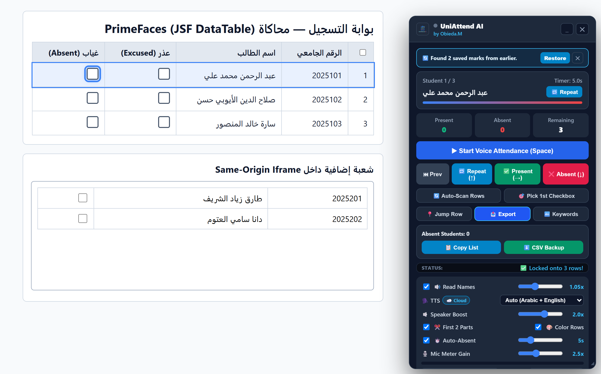
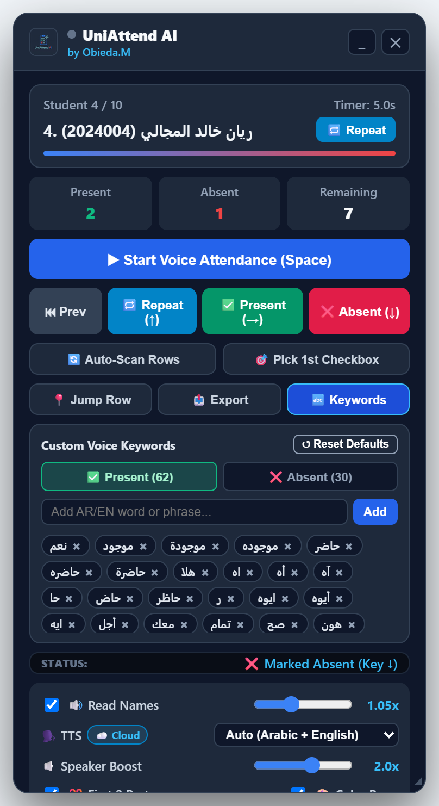

<p align="center">
  
</p>

<h1 align="center">UniAttend AI</h1>

<p align="center">
  <strong>Bilingual (Arabic / English) Voice-Assisted Attendance Automation for University Portals</strong><br />
  Fast, private, on-demand Manifest V3 Chrome &amp; Edge Extension • Built by Obieda.M
</p>

<p align="center">
  <a href="https://github.com/ObiedaM/Uni-Attend-AI/actions/workflows/ci.yml"></a>
  <a href="https://github.com/ObiedaM/Uni-Attend-AI/releases/latest"></a>
  
  
  
  
</p>

---

## Install in 30 Seconds (Download → Unzip → Load Unpacked)

No coding, no Node.js, no terminal required.

1. **Download** [**`UniAttend-AI-v2.1.0.zip`**](https://github.com/ObiedaM/Uni-Attend-AI/releases/latest) *(40 KB, pre-built from GitHub Releases — do not use the green `Code → Download ZIP` button)*.
2. **Unzip** the downloaded archive into any folder.
3. Open **`chrome://extensions/`** (or **`edge://extensions/`**) and enable **Developer mode** (top-right).
4. Click **Load unpacked** and select the unzipped folder.
5. Open any university attendance page and press **`Alt + A`** (or click the toolbar icon).

> **Chrome Web Store Ready:** Multi-resolution icons (`16/32/48/128`), strict MV3 CSP, least-privilege permissions, and [PRIVACY.md](PRIVACY.md) are already prepared for upcoming Chrome Web Store publication.

---

## Live Preview & Feature Showcase

<p align="center">
  
  <br />
  <sub><em>Floating Shadow DOM HUD running on an anonymized Arabic RTL portal — real-time green Present / red Absent highlighting, active blue cursor, Cloud/Offline TTS badge, and 1-click tools.</em></sub>
</p>

<table>
  <tr>
    <td width="62%" valign="top">
      
      <p align="center"><sub><b>PrimeFaces <code>.ui-chkbox</code> &amp; Same-Origin Iframes:</b> Column-locked scanning, <b>Session Recovery</b> restore banner after accidental refresh, and 1-click <b>Copy / CSV Backup</b>.</sub></p>
    </td>
    <td width="38%" valign="top">
      
      <p align="center"><sub><b>Custom Voice Keywords Drawer:</b> Add/remove Arabic, English, or classroom-dialect trigger words on the fly (persisted locally).</sub></p>
    </td>
  </tr>
</table>

---

## Core Features

* **Zero Idle Footprint (On-Demand Only):** Zero persistent `<all_urls>` `content_scripts`. Nothing runs during normal browsing until you explicitly press `Alt + A` or click the icon.
* **Fast Bilingual Speech Recognition (AR + EN):** Real-time interim matching (`~650ms` cooldown) for Jordanian/Levantine Arabic, MSA, English, phonetic spellings, and real-world clipped classroom speech—with whole-word & word-boundary phrase collision protection (`هلا` / `شغال` never trigger `لا` / `غا`).
* **Resilient Bilingual TTS + Live Status Badge:** Reads each student's name before starting the response countdown, with a **First 2 Parts** compound Arabic name parser (`عبد الرحمن`, `صلاح الدين`), `0.8x–1.5x` speed, `0.5x–3.0x` Web Audio speaker boost + limiter, `~0ms` repeat cache, and automatic offline/rate-limit OS fallback so the timer never stalls.
* **Hardware Mic-Mute Guard:** Watches both `MediaStreamTrack` mute events and raw Web Audio digital-zero (`128`) flatline frames (~1.75s) to catch Lenovo/Realtek hardware mic-mute keys and pause the countdown automatically.
* **1-Click Absent Export (Clipboard & Excel-Safe CSV):** Export all marked Absent students (Name + extracted ID) as plain text or UTF-8 BOM `.csv` (with CSV formula-injection neutralization) before portal sessions time out.
* **Click-Row-to-Jump (`Alt + Click` or Jump Toggle):** Jump the active cursor directly to any scanned student row, including rows inside same-origin iframes.
* **Session Recovery Guard:** Caches marked statuses in URL-scoped `sessionStorage` so an accidental refresh offers a 1-click **Restore** banner.
* **Universal Portal Engine:** Works on JSF/PrimeFaces (`.ui-chkbox`, e.g., University of Jordan `ujapps.ju.edu.jo/regapp/`), HTML tables, React/Vue controlled inputs, ARIA `[role="checkbox"]`, open Shadow DOMs, same-origin iframes, **Pick 1st Checkbox** column locking, and both **Checked = Absent** and **Checked = Present** rules.

---

## Verifiable Safety & Security Proof

UniAttend AI has **no custom backend, no analytics, no telemetry, and no ads**. Every security guarantee is **automatically verified on every commit and release** in public [GitHub Actions CI](https://github.com/ObiedaM/Uni-Attend-AI/actions) — you do not have to take our word for it:

| Security Guarantee | How It Is Enforced | Independent Verification Proof |
| :--- | :--- | :--- |
| **Zero Background Tracking / Idle Footprint** | `public/manifest.json` declares **no** `content_scripts` and **no** `<all_urls>`. Uses `activeTab` + `scripting` on explicit user click / `Alt + A` only. | Verified by Playwright E2E (`#uni-attend-ai-host` count = `0` on page load) + `npm run security:check`. |
| **Zero Extension Fingerprinting** | Declares **zero** `web_accessible_resources`. Icon is served strictly over authenticated `chrome.runtime` IPC (`sender.id === chrome.runtime.id`). | Verified by `npm run security:check` + inspect `manifest.json` inside the ZIP. |
| **Zero Dynamic Code / XSS Sinks** | Strict CSP (`script-src 'self'; object-src 'none'`). Zero `eval()`, `new Function()`, `document.write()`, `outerHTML`, or untrusted `innerHTML` (all names/chips use `textContent`). | Automated static bundle scan across `dist/background.js` & `dist/content.js` on every CI run. |
| **Audited Outbound Network Surface** | Compiled bundle contains **only 1** external URL (`translate.googleapis.com/translate_tts`), called with `credentials: "omit"`, `referrerPolicy: "no-referrer"`, 3.5s timeout, MIME check, and 512 KB cap. Switch to any **System Voice (Offline)** for 0 TTS requests. | `npm run security:check` lists every URL in `dist/` and fails CI if any other URL appears. |
| **Hard Hardware Mic Teardown** | Pausing, finishing, closing (`✕`), or `pagehide` immediately stops all `MediaStreamTrack`s (race-guarded against pending `getUserMedia`), closes all `AudioContext`s, and aborts `SpeechRecognition`. | Chrome's red tab mic indicator disappears immediately; enforced in `src/audio/mic-monitor.ts` & `src/audio/feedback.ts`. |
| **Zero Known Vulnerabilities & Tamper-Evident Releases** | Zero runtime dependencies (pure compiled TypeScript). Dev dependencies checked via `npm audit --audit-level=moderate` (`0 vulnerabilities`). Every release ships with `SHA256SUMS.txt`. | Compare downloaded ZIP hash against `SHA256SUMS.txt` on the Release page. |

### Verify Any Release Yourself (30 Seconds)

**1. Verify the Release ZIP SHA-256 Checksum (Windows PowerShell / macOS / Linux):**
```powershell
# Windows PowerShell
(Get-FileHash .\UniAttend-AI-v2.1.0.zip -Algorithm SHA256).Hash.ToLower()
# Compare output with SHA256SUMS.txt from the GitHub Release page
```
```bash
# macOS / Linux
sha256sum -c SHA256SUMS.txt
```

**2. Run the Automated Security, Unit & Browser E2E Audit from Source:**
```bash
npm ci
npm audit --audit-level=moderate   # Confirms 0 vulnerabilities
npm run build
npm run security:check             # Audits dist/ manifest, CSP, dangerous sinks & every URL
npm test                           # 21 Vitest unit tests (Arabic NLP, collisions, export, storage)
npm run test:e2e                   # Playwright E2E against compiled dist/ in Chromium
```

### Network Transparency Summary
* **100% Local:** Portal rosters, student IDs, cookies, CSV exports, settings (`chrome.storage.local`), tab recovery (`sessionStorage`), and mic VU/mute monitoring never leave your browser. Portal submission always uses your university portal's own Save button.
* **Browser Built-In STT:** When Voice Attendance is actively running, Chrome/Edge's native `webkitSpeechRecognition` streams mic audio to the browser vendor's speech service to return live transcripts.
* **Optional Cloud TTS:** When a Neural Cloud voice is selected, `background.js` sends *only* the cleaned spoken student name (numbers/IDs stripped, max 120 chars) to `translate.googleapis.com`. Select any **System Voice (Offline)** in the HUD for 100% offline TTS.
* Full Chrome Web Store–compliant policy: **[PRIVACY.md](PRIVACY.md)**.

---

## Keyboard Shortcuts

| Shortcut | Action |
| :--- | :--- |
| `Alt + A` | Open / Close UniAttend AI on the active tab |
| `Space` | Pause active attendance (releases mic hardware immediately) |
| `Alt + Space` | Start / Pause attendance |
| `→` / `↓` | Mark current student **Present** / **Absent** and advance |
| `↑` / `←` | Repeat current student's name / Step back to previous student |
| `Alt + Click` | Jump active cursor directly to any scanned student row |
| `Esc` | Cancel **Pick 1st Checkbox** or **Jump Row** mode |

---

## Project Structure & Local Development

Clean modular TypeScript (`src/`) bundled via esbuild (`scripts/build.mjs`) into `dist/` (`4.3 KB` worker + `68.6 KB` content script):

```text
src/
├── background.ts     # MV3 service worker (on-demand injector, true LRU TTS cache, strict sender.id)
├── content.ts        # Attendance state machine coordinator
├── dom/              # Multi-doc/iframe scanner, PrimeFaces/React/ARIA mutator, column locking
├── nlp/              # Arabic/English normalizer, collision-safe matcher, 2-part compound name parser
├── audio/            # Mic flatline mute guard, Web Audio CSP-proof TTS player, chime feedback
├── speech/           # webkitSpeechRecognition controller with TTS echo suppression
├── ui/               # Isolated Shadow DOM HUD, drag/resize/viewport clamp, iframe-safe shortcuts
└── shared/           # Types, defaults, clamped storage wrapper, UTF-8 BOM CSV export, session guard
```

```bash
npm install        # Install dev tools (Node.js 20+)
npm run dev        # Watch mode -> dist/ (Load unpacked from dist/ in chrome://extensions/)
npm run build      # Production build -> dist/
npm run package    # Version sync + build + security:check + release/UniAttend-AI-v<ver>.zip + SHA256SUMS.txt
```

**Try locally without a portal login:** Enable **Allow access to file URLs** on the extension's Details page, open `demo/test-portal.html` or `demo/primefaces-mock.html`, and press `Alt + A`.

---

## License

MIT License — see [LICENSE](LICENSE).
