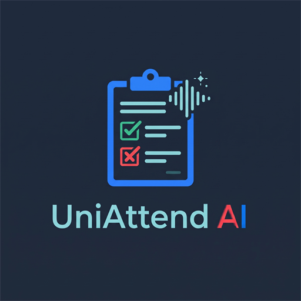

<p align="center">
  
</p>

<h1 align="center">UniAttend AI</h1>

<p align="center">
  <strong>Bilingual (Arabic / English) Voice-Assisted Attendance Automation for University Portals</strong><br />
  Fast, private, on-demand Manifest V3 Chrome &amp; Edge Extension • Built by Obieda.M
</p>

<p align="center">
  <a href="https://github.com/ObiedaM/Uni-Attend-AI/actions/workflows/ci.yml"></a>
  <a href="https://github.com/ObiedaM/Uni-Attend-AI/releases"></a>
  
  
  
</p>

---

## Overview

**UniAttend AI** automates repetitive roll-call clicking on university faculty portals—including legacy JSF/PrimeFaces systems (such as University of Jordan's `ujapps.ju.edu.jo/regapp/`), standard HTML tables, React/Vue apps, ARIA checkboxes, open Shadow DOMs, and same-origin iframes.

Under the hood, the extension is a **deterministic, zero-runtime-dependency TypeScript state machine and DOM engine**—there is no custom LLM and no developer backend. It connects browser-native speech recognition (`Web Speech API`), audio signal monitoring (`Web Audio API`), and bilingual Text-to-Speech (TTS) to call student names aloud, listen for Arabic/English responses, toggle checkboxes accurately, and advance down the roster.

<p align="center">
  
</p>

---

## Quick Install (60 Seconds — No Coding Required)

> **Chrome Web Store:** Packaging, icons, CSP, and privacy policy are Chrome Web Store–ready for upcoming store publication. Until then, install directly from GitHub Releases in 1 minute:

1. Download **`UniAttend-AI-v2.1.0.zip`** from [**GitHub Releases**](https://github.com/ObiedaM/Uni-Attend-AI/releases/latest).
2. Extract the ZIP to a folder on your computer.
3. Open `chrome://extensions/` (or `edge://extensions/`).
4. Turn on **Developer mode** (top-right toggle).
5. Click **Load unpacked** and select the extracted folder.
6. Open your university attendance portal and press **`Alt + A`** (or click the toolbar icon).

---

## Key Features

* **Zero Idle Footprint (On-Demand Injection):** No persistent `<all_urls>` `content_scripts`. Nothing runs during normal browsing until you click the toolbar icon or press `Alt + A`.
* **Fast Bilingual Voice Recognition (AR + EN) + Custom Keywords:** Real-time interim matching (~650ms cooldown) for Jordanian/Levantine Arabic, MSA, English, phonetic transcriptions, and real-world clipped classroom speech—with whole-word and word-boundary phrase collision protection (`هلا` / `شغال` never trigger `لا` / `غا`). Customize keywords live inside the HUD's collapsible **Keywords** drawer.
* **Resilient Bilingual TTS with Live Status Badge:** Calls student names before starting the response countdown, featuring a **First 2 Parts** compound Arabic name parser (`عبد الرحمن`, `صلاح الدين`), speed (`0.8x–1.5x`), speaker boost (`0.5x–3.0x`) with a dynamics limiter, `~0ms` repeat cache, and a live engine badge (`☁️ Cloud` / `⚡ Cached` / `💻 Offline OS` / `⚠️ Fallback`) with automatic rate-limit/offline fallback so the timer never stalls.
* **Hardware Mic-Mute Guard:** Combines `MediaStreamTrack` mute events with raw Web Audio digital-zero (`128`) flatline detection (~1.75s) to detect laptop hardware mic-mute keys (Lenovo/Realtek) and freeze the countdown automatically until unmuted.
* **1-Click Absent List Export (Copy & CSV):** Copy currently marked Absent students (Name + extracted Student ID) to your clipboard or download a dated, Excel-safe UTF-8 BOM `.csv` backup before portal sessions time out.
* **Click-Row-to-Jump Cursor:** Use **`Alt + Click`** on any scanned student row (or click the **Jump Row** toggle) to move the cursor directly to that student—including inside same-origin iframes.
* **Session Recovery Guard:** Temporarily caches marked Present/Absent statuses in URL-scoped `sessionStorage` so an accidental page refresh surfaces a 1-click **Restore** banner.
* **Universal Portal Compatibility:** Supports standard HTML inputs, JSF/PrimeFaces `.ui-chkbox`, React/Vue controlled inputs (native prototype setter), ARIA `[role="checkbox"]`, open Shadow DOMs, same-origin iframes, **Pick 1st Checkbox** column locking, and both **Box Checked = Absent** and **Box Checked = Present** modes.

---

## Architecture

Clean modular TypeScript under `src/` compiled with **esbuild** into a tiny, zero-dependency `dist/` bundle (`~4 KB` service worker + `~67 KB` content script, `~42 KB` release ZIP):

```text
[ Toolbar Click / Alt + A ]
             │
             ▼
┌────────────────────────────────────┐   True LRU Cache + Timeout    ┌──────────────────────────┐
│  src/background.ts (MV3 Worker)    │ ◄───────────────────────────► │ Cloud TTS Endpoint (Opt) │
│  • On-demand executeScript         │    (512 KB cap + MIME check)  └──────────────────────────┘
│  • Internal icon48.png IPC         │
└────────────────────────────────────┘
             │
             │  chrome.scripting.executeScript -> dist/content.js
             ▼
┌─────────────────────────────────────────────────────────────────────────────────────────────────┐
│                       src/content.ts (Attendance State Machine + Shadow HUD)                    │
├───────────────────┬───────────────────┬───────────────────┬───────────────────┬─────────────────┤
│     src/dom/      │     src/nlp/      │    src/audio/     │    src/speech/    │     src/ui/     │
│ • documents.ts    │ • normalize.ts    │ • feedback.ts     │ • recognizer.ts   │ • hud.ts        │
│ • scanner.ts      │ • keywords.ts     │ • mic-monitor.ts  │  (AR/EN interim + │ • hud-template  │
│ • mutator.ts      │ • names.ts        │ • tts.ts          │   echo suppress)  │ • shortcuts.ts  │
├───────────────────┴───────────────────┴───────────────────┴───────────────────┴─────────────────┤
│ src/shared/: types.ts • constants.ts • storage.ts (validated) • export.ts • session.ts          │
└─────────────────────────────────────────────────────────────────────────────────────────────────┘
```

---

## Privacy, Security & Network Transparency

No custom backend, no analytics, no telemetry. Full policies: [PRIVACY.md](PRIVACY.md) • [SECURITY.md](SECURITY.md).

### What Stays 100% Local
* **Portal Data, Credentials & CSV Exports:** Student rosters, IDs, cookies, and final form submissions never leave your browser tab. Attendance is only submitted when you click the university portal's own Save button.
* **Preferences & Tab Recovery:** Validated settings and custom keywords live in `chrome.storage.local`; refresh recovery snapshots live strictly in tab-scoped `sessionStorage`.
* **Audio Monitoring & Hard Hardware Teardown:** The VU meter and flatline guard run purely in local Web Audio memory. Pausing, completing the list, closing (`✕`), or `pagehide` immediately stops all `MediaStreamTrack`s, closes all `AudioContext`s, and aborts `SpeechRecognition`.
* **CSP & Anti-Fingerprinting:** Zero `web_accessible_resources`, strict `sender.id === chrome.runtime.id` checks, `script-src 'self'; object-src 'none'` CSP, `textContent`-only rendering for page/user text, and Web Audio memory decoding for TTS.

### What Contacts External Endpoints (Full Disclosure)
1. **Browser Speech-to-Text (`webkitSpeechRecognition`):** While voice listening is active, Chrome/Edge natively streams microphone audio to the browser vendor's cloud speech recognition service to return live transcripts.
2. **Optional Cloud TTS (`translate.googleapis.com`):** When a **Neural Cloud** voice is chosen, `background.ts` sends *only* the cleaned spoken name string (stripped of IDs/numbers, max 120 chars) with `credentials: "omit"` and `referrerPolicy: "no-referrer"`. **For 100% offline TTS**, select any **System Voice (Offline)** in the HUD's TTS dropdown.

### Permissions Explained

| Permission | Why It's Needed |
| :--- | :--- |
| `activeTab` & `scripting` | Injects `content.js` only into the current tab after you click the icon or press `Alt + A`. |
| `storage` | Persists validated HUD preferences and custom voice keywords locally. |
| `host_permissions` (`translate.googleapis.com`) | Fetches optional Cloud TTS audio cleanly from the service worker without triggering page CSP blocks. |

---

## Keyboard Shortcuts & Controls

| Shortcut | Action |
| :--- | :--- |
| `Alt + A` | Open / Close UniAttend AI on the current tab |
| `Space` | Pause active attendance (releases microphone hardware immediately) |
| `Alt + Space` | Start / Pause attendance |
| `→` (Right Arrow) | Mark current student **Present** and advance |
| `↓` (Down Arrow) | Mark current student **Absent** and advance |
| `↑` (Up Arrow) | Repeat current student's name aloud & reset timer |
| `←` (Left Arrow) | Move back to previous student |
| `Alt + Click` (on row) | Jump active cursor directly to that student row |
| `Esc` | Cancel **Pick 1st Checkbox** or **Jump Row** mode |

---

## Developer Setup, Testing & Packaging

Requires **Node.js 20+**.

```bash
# 1. Install dev dependencies
npm install

# 2. Build production extension -> dist/
npm run build
```

Then open `chrome://extensions/`, enable **Developer mode**, click **Load unpacked**, and select the **`dist/`** folder (not the repo root).

```bash
npm run dev        # Watch mode -> auto-rebuilds dist/ on save
npm run typecheck  # Strict TypeScript check (tsc --noEmit)
npm run lint       # ESLint 9 flat config
npm test           # Vitest unit tests
npm run test:e2e   # Playwright E2E tests against built dist/ (run `npx playwright install chromium` once)
npm run package    # Sync version -> public/manifest.json, build dist/, create release/UniAttend-AI-v<ver>.zip
```

### Try Locally Without a Portal Login
1. On `chrome://extensions/`, click **Details** on UniAttend AI and enable **Allow access to file URLs**.
2. Open `demo/test-portal.html` or `demo/primefaces-mock.html` in Chrome/Edge.
3. Press **`Alt + A`** to launch the HUD.

---

## Known Limitations & Trade-offs

* **Room Acoustics:** Like any browser-based speech recognizer, accuracy drops in large, noisy lecture halls with only a built-in laptop mic. Works best in labs/seminars or with a directional/lapel mic (keyboard arrows and `Alt + Click` are instant fallbacks).
* **Unofficial Cloud TTS Endpoint:** Optional Neural Cloud voices use Google Translate's public `translate_tts` endpoint (`client=tw-ob`), which may rate-limit without notice. On error or offline mode, a 60s circuit breaker automatically switches to local OS `speechSynthesis` voices without stalling the attendance timer.
* **Browser Support:** Requires Chromium-based browsers (Chrome or Edge 116+) supporting `webkitSpeechRecognition`.

---

## License

MIT License — see [LICENSE](LICENSE) for full details.
