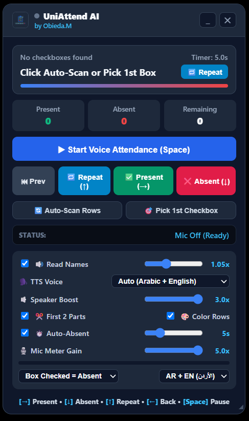

<p align="center">
  
</p>

<h1 align="center">UniAttend AI</h1>

<p align="center">
  <strong>Bilingual (Arabic / English) Voice-Assisted Attendance Automation for University Portals</strong><br />
  On-demand Manifest V3 Chrome &amp; Edge Extension • Built by Obieda.M
</p>

<p align="center">
  
  
  
  
</p>

---

## Overview

**UniAttend AI** automates repetitive roll-call clicking on university faculty portals (including legacy JSF/PrimeFaces tables, standard HTML forms, React/Vue apps, and same-origin iframes).

Under the hood, the extension itself is a **deterministic JavaScript state machine and DOM automation engine**—it does not run a custom LLM or external backend. Instead, it connects browser-native speech recognition (`Web Speech API`), audio signal monitoring (`Web Audio API`), and Text-to-Speech (TTS) to call student names aloud, listen for bilingual attendance responses, toggle the portal's checkboxes, and advance down the roster.

<p align="center">
  
</p>

---

## Key Features

* **On-Demand Injection (Zero Idle Footprint):** No persistent `<all_urls>` content scripts. Zero code runs during normal browsing until you click the toolbar icon or press `Alt + A`.
* **Bilingual Voice Recognition (AR + EN):** Real-time keyword matching for Jordanian/Levantine Arabic, MSA, English, and phonetic transcriptions (`نعم`, `موجود`, `حاضر`, `هلا`, `Yes`, `Here`, `غائب`, `Absent`, `Skip`, etc.).
* **Native Arabic & English TTS:** Calls each student's name before starting the response timer. Includes a **First 2 Parts** parser (handles compound Arabic names like `عبد الرحمن`), speed control (`0.8x–1.5x`), a Web Audio speaker boost (`0.5x–3.0x`) with a dynamics limiter, and an in-memory LRU audio cache for instant repeats.
* **Hardware Mic-Mute Guard:** Monitors both `MediaStreamTrack` mute events and a Web Audio time-domain digital-zero flatline detector (`128` silence floor). If a laptop's hardware mic-mute key is left on, the countdown timer freezes automatically and resumes once unmuted.
* **Universal Portal Compatibility:** Supports standard HTML checkboxes, PrimeFaces `.ui-chkbox`, React/Vue controlled inputs (via native prototype setters), ARIA `[role="checkbox"]`, open Shadow DOMs, and same-origin iframes. Supports both **Box Checked = Absent** and **Box Checked = Present** modes.
* **Persistent Preferences:** Saves your voice selection, sliders, timer, portal check-mode, and HUD width locally via `chrome.storage.local`.

---

## Architecture

```text
[ Toolbar Click / Alt + A ]
             │
             ▼
┌─────────────────────────────────┐      LRU Cache + Base64 MP3      ┌──────────────────────────┐
│  background.js (Service Worker) │ ◄──────────────────────────────► │ Cloud TTS Endpoint (Opt) │
└─────────────────────────────────┘                                  └──────────────────────────┘
             │
             │  chrome.scripting.executeScript (On-Demand)
             ▼
┌───────────────────────────────────────────────────────────────────────────────────────────────┐
│                                content.js (Isolated Shadow DOM HUD)                           │
├─────────────────────────┬─────────────────────────┬──────────────────────────┬────────────────┤
│  Universal DOM Engine   │     Web Speech API      │      Web Audio API       │ Local Storage  │
│  • Tables & PrimeFaces  │  • Real-Time AR/EN STT  │  • Mic Flatline Guard    │ • Settings     │
│  • Shadow DOM & Iframes │  • Keyword State Machine│  • 2x–3x Speaker Limiter │ • HUD Width    │
└─────────────────────────┴─────────────────────────┴──────────────────────────┴────────────────┘
```

---

## Privacy, Security & Network Transparency

This project has **no custom backend, no analytics, and no telemetry**. However, because browser speech APIs involve external services, here is the exact breakdown of what stays on your machine and what touches the network:

### What Stays 100% Local
* **Portal Data & Credentials:** Student IDs, full roster tables, session cookies, passwords, and final form submissions never leave the browser tab. Submitting attendance still relies strictly on the university portal's own Save button.
* **Settings & Audio Monitoring:** Preferences are stored in `chrome.storage.local`. The microphone VU meter and hardware-mute flatline detector run entirely in local Web Audio memory.
* **Hard Mic Teardown:** Pausing, completing the list, closing (`✕`), or navigating away (`pagehide`) immediately stops all `MediaStreamTrack` instances and closes the `AudioContext`.

### What Contacts External Endpoints (Full Disclosure)
1. **Browser Speech-to-Text (`webkitSpeechRecognition`):** When attendance listening is actively running, Chrome/Edge natively streams microphone audio to the browser vendor's cloud speech recognition service (Google in Chrome) to transcribe words in real time.
2. **Optional Cloud TTS (`translate.googleapis.com`):** When a **Neural Cloud** voice is selected, `background.js` sends *only* the cleaned spoken name string (stripped of numbers/IDs, max 120 chars) with `credentials: "omit"` and `referrerPolicy: "no-referrer"` to fetch pronunciation audio. **To make TTS 100% offline**, select any **System Voice (Offline)** from the TTS Voice dropdown inside the HUD.

### Permissions Explained

| Permission | Why It's Needed |
| :--- | :--- |
| `activeTab` & `scripting` | Injects `content.js` only into the current tab when you explicitly click the icon or press `Alt + A`. |
| `storage` | Persists your HUD sliders, language, voice, and checkbox mode locally across sessions. |
| `host_permissions` (`translate.googleapis.com`) | Allows `background.js` to fetch and decode optional Cloud TTS audio cleanly without triggering page CSP blocks. |

---

## Known Limitations & Trade-offs

* **Room Acoustics:** Like any browser-based speech recognizer, accuracy drops in large, noisy lecture halls when relying solely on a built-in laptop microphone. Works best in smaller labs/seminars or paired with a directional/lapel mic (keyboard arrows are always available as an instant fallback).
* **Unofficial Cloud TTS Endpoint:** The optional Neural Cloud voice uses Google Translate's public `translate_tts` endpoint (`client=tw-ob`), which is undocumented and could be rate-limited or deprecated without notice. If it fails or you are offline, the extension automatically falls back to local OS `speechSynthesis` voices.
* **Browser Support:** Requires Chromium-based browsers (Chrome or Edge) that implement `webkitSpeechRecognition`.

---

## Keyboard Shortcuts

| Shortcut | Action |
| :--- | :--- |
| `Alt + A` | Open / Close UniAttend AI on the current tab |
| `Space` | Pause active attendance (releases microphone hardware) |
| `→` (Right Arrow) | Mark current student **Present** and advance |
| `↓` (Down Arrow) | Mark current student **Absent** and advance |
| `↑` (Up Arrow) | Repeat current student's name aloud & reset timer |
| `←` (Left Arrow) | Move back to previous student |
| `Esc` | Cancel **Pick 1st Checkbox** targeting mode |

---

## Installation (Chrome / Edge)

1. Download **`UniAttend-AI-v2.0.0.zip`** from the [**Releases**](https://github.com/ObiedaM/Uni-Attend-AI/releases) page (or clone this repository).
2. Extract the archive into a local folder.
3. Open `chrome://extensions/` (or `edge://extensions/`).
4. Enable **Developer mode** in the top-right corner.
5. Click **Load unpacked** and select the extracted folder.
6. Navigate to any attendance page and press **`Alt + A`** (or click the extension icon).

## Try It Locally (No Portal Login Required)

1. On `chrome://extensions/`, click **Details** on UniAttend AI and enable **Allow access to file URLs**.
2. Open `demo/test-portal.html` in Chrome.
3. Press **`Alt + A`** and click **Start Voice Attendance**.

---

## License

MIT License — see [LICENSE](LICENSE) for full details.
